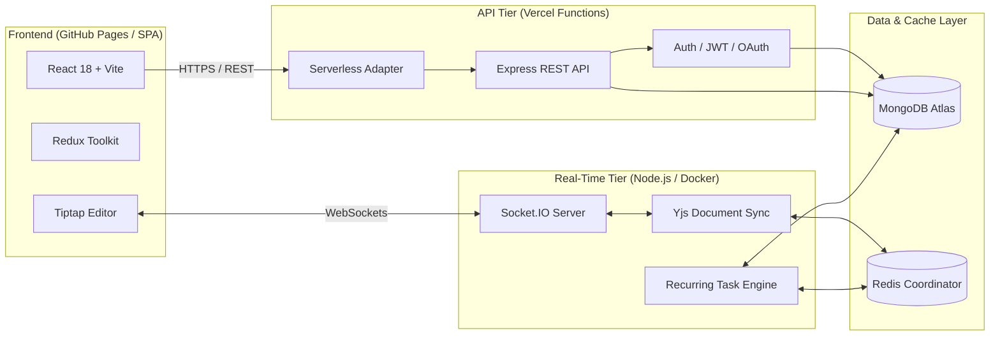

# Klavo

Klavo is a modern, real-time project management and collaborative document platform combining Kanban workflows, CRDT-backed rich text editing, automated task engines, and enterprise access controls.

## Live Application

- **Live Frontend**: [https://thisisanimesh01.github.io/Klavo/](https://thisisanimesh01.github.io/Klavo/)
- **Production API**: [https://klavo-backend.vercel.app/api/health](https://klavo-backend.vercel.app/api/health)

## Architecture & Workflow



## Tech Stack

- **Frontend**: React 18, Vite, Redux Toolkit, Tailwind CSS, Tiptap, Lucide Icons
- **Backend**: Node.js, Express, Socket.IO, Yjs CRDTs, Mongoose
- **Databases & Cache**: MongoDB Atlas, Redis (Pub/Sub & Distributed Locks)
- **Authentication**: JWT Cookies, Google Sign-In, GitHub OAuth, SAML / OIDC SSO
- **Deployment & Hosting**: GitHub Pages (Client SPA), Vercel Serverless (REST API), Docker / Cloud Containers (WebSockets & Real-time Sync)
- **Quality & Testing**: Node.js Native Test Runner, Playwright E2E, Automated Secret Scans

## Local Development

### Prerequisites
- Node.js >= 20
- MongoDB 6.0+

### Setup

```bash
# Clone repository
git clone https://github.com/thisisanimesh01/Klavo.git
cd Klavo

# Install all dependencies
npm install
cd backend && npm install && cd ..
cd frontend && npm install && cd ..
```

### Running Locally

```bash
# Terminal 1: Start Backend (Port 5050)
cd backend && npm run dev

# Terminal 2: Start Frontend (Port 5173)
cd frontend && npm run dev
```

Visit `http://localhost:5173`.

## Testing

```bash
# Backend unit & integration test suite
node --test backend/tests/*.test.js

# Frontend test suite
node --test frontend/tests/*.test.js

# Playwright End-to-End tests
npx playwright test

# Secret leak scan
node scripts/scan_secrets.js
```

## Documentation

Full architectural guides and specifications:
- [Vercel Serverless Deployment Guide](docs/VERCEL_DEPLOYMENT.md)
- [Enterprise Architecture](docs/ENTERPRISE_ARCHITECTURE.md)
- [Real-Time Collaboration](docs/COLLABORATION.md)
- [Automation Engine](docs/AUTOMATION_ARCHITECTURE.md)
- [Integrations & Webhooks](docs/INTEGRATIONS_ARCHITECTURE.md)
