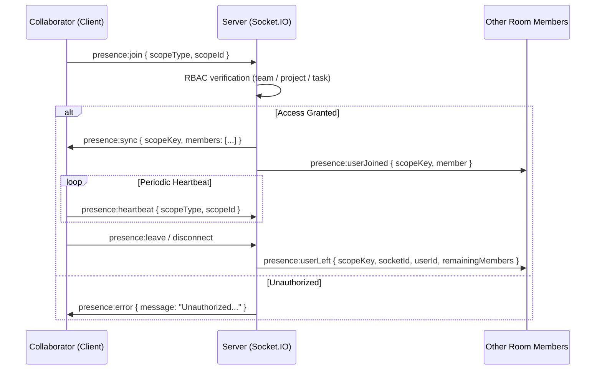

# Real-Time Collaboration & Presence Architecture (COLLAB-01)

## Overview

Klavo implements a real-time collaboration layer providing:
1. **User Presence & Awareness**: Live online/offline member rosters across teams, projects, and active tasks.
2. **Conflict-Free Document Editing**: CRDT synchronization backed by Yjs with multi-cursor rendering, selection tracking, and authoritative version rollback epoch fences.
3. **Task Collaboration Rooms**: Live task viewer indicators, instant comment synchronization, emoji reactions, and mention notifications.
4. **Live Activity Feeds**: Event-driven project audit trail broadcasts without client polling.
5. **Tenancy & Authorization Guards**: Strict RBAC validation on all socket subscriptions preventing cross-tenant data leaks and unauthorized room snooping.

---

## 1. Socket Architecture & Room Tenancy

All real-time communication is coordinated through a modular Socket.IO server (`backend/src/index.js` and `backend/src/sockets/*`):

| Scope | Room Identifier | Security Guard | Event Broadcasts |
| :--- | :--- | :--- | :--- |
| **User Notifications** | `user_${userId}` | Authenticated user matches target ID | `notificationCreated`, `preferenceUpdated` |
| **Team Scope** | `team_${teamId}` | `checkTeamAccess(teamId, user._id)` | `projectCreated`, `teamMemberAdded` |
| **Project Scope** | `project_${projectId}` | `checkProjectAccess(projectId, user._id)` | `taskUpdated`, `commentAdded`, `activityCreated`, `wiki*` |
| **Task Scope** | `task_${taskId}` | `checkTaskAccess(taskId, user._id)` | `task:viewersUpdated` |
| **Document Scope** | `doc_collab_${docId}` | `resolveDocumentAccess(doc, user._id)` | `docSyncUpdate`, `collabCursorMoved`, `collabUserJoined`, `collabUserLeft` |
| **Global Presence** | `team_*` / `project_*` / `task_*` | Respective RBAC checks | `presence:sync`, `presence:userJoined`, `presence:userLeft` |

---

## 2. Real-Time Presence Lifecycle

The presence module (`backend/src/sockets/presence.js`) maintains an in-memory presence registry indexed by scope:

### Event Contracts
- `presence:join` (`{ scopeType: "team"|"project"|"task", scopeId: string }`): Authenticated request to join a presence channel.
- `presence:sync` (`{ scopeKey, scopeType, scopeId, members: Array<Collaborator> }`): Authoritative snapshot returned on entry.
- `presence:userJoined` (`{ scopeKey, scopeType, scopeId, member: Collaborator }`): Notification emitted to other room peers.
- `presence:userLeft` (`{ scopeKey, socketId, userId, remainingMembers: Array<Collaborator> }`): Dispatched when a client explicitly leaves or disconnects.
- `presence:heartbeat` (`{ scopeType, scopeId }`): Heartbeat ping resetting the collaborator's `lastSeen` timestamp.

---

## 3. Document Collaboration & Yjs CRDT Synchronization

Document collaboration uses Yjs (`backend/src/sockets/documents.js`), an operational-transformation-free CRDT:

1. **State Initialization (`joinDocumentCollab`)**:
   - The server verifies document-level permissions (`resolveDocumentAccess`).
   - If granted, the server sends `docSyncInit` containing the base64-encoded Yjs binary update, the active collaborator list, the user's cursor color, and the authoritative `restoreEpoch`.
2. **Incremental Synchronizations (`docSyncUpdate`)**:
   - Client sends incremental delta updates over Socket.IO.
   - Server applies updates using `Y.applyUpdate(room.doc, binary)` and broadcasts to room peers via `socket.to(roomKey).emit("docSyncUpdate", ...)`.
   - In multi-instance deployments, changes are cross-published via Redis pub/sub.
3. **Epoch Protection Gate**:
   - When a document version is restored from history, the server increments `restoreEpoch` and broadcasts `docResetState`.
   - Stale in-flight updates generated before the restore are rejected by the epoch gate, preventing resurrection of rolled-back state.
4. **Reconnect & State Recovery (`docSyncResync`)**:
   - Reconnecting clients emit `docSyncResync` to immediately receive a clean snapshot without requiring a full browser page refresh.

---

## 4. Task Viewing & Live Collaboration

Task modal and detail views utilize `initTaskSockets`:
- `task:join` / `task:leave`: Clients announce when viewing or editing a specific task.
- `task:viewersUpdated`: Real-time list of active viewers for the task avatar stack.
- Real-time comments (`commentAdded`) and reactions (`reactionAdded`) are delivered instantaneously to open modal sessions.

---

## 5. Security & Isolation Controls

1. **IDOR & Data Boundary Enforcement**:
   - Every socket room join operation verifies database permissions via `checkTeamAccess`, `checkProjectAccess`, or `checkTaskAccess`.
   - Sockets missing a valid JWT or lacking explicit permissions receive error events and are denied entry.
2. **Memory Leak Mitigation**:
   - Disconnecting sockets trigger recursive cleanup in `cleanupSocketPresence`, `cleanupSocketTaskRooms`, and `handleLeaveDocRoom`.
   - Empty rooms are automatically flushed to MongoDB and deleted from memory.
3. **No Unencrypted Secrets**:
   - Sockets communicate over TLS in production (`wss://`).
   - Handshake authentication uses JWTs verified with server-side secrets.
